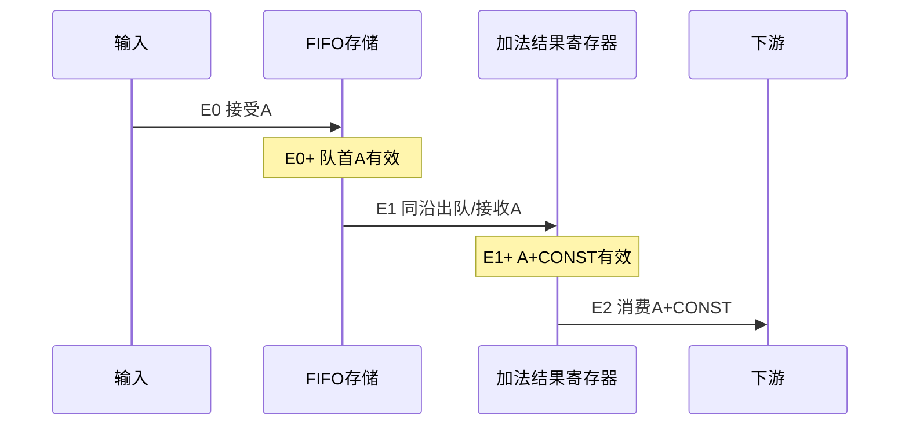

# 同一笔数据怎样跨过两个时序模块

这是计拍示例，条件均显式给出：单上升沿时钟、复位已解除、空时不直通的FIFO、深度4、后接一个可阻塞的加常数寄存级、没有额外输出寄存。FIFO空时输出无效；加法级在空闲或旧输出本沿可消费时允许替换。它对应工具仓库的tiny-stream示例，不是新项目的默认架构。

关键行为可概括为：

```text
FIFO: push = s_valid && s_ready; pop = m_valid && m_ready
      s_ready = rst_n && count < DEPTH
      m_valid = rst_n && count != 0
      m_data = storage[read_ptr]                 // 组合读取
ADD:  s_ready = rst_n && (!out_valid || m_ready)
      接受时将 data+CONST 写入 out_data；out_valid同步更新
```

## 空载：接受到消费最少两拍

下表各沿前的握手信号用于判断该沿事件，沿后为寄存更新/组合稳定后的值。E0开始时FIFO与加法级均空，外部m_ready持续为1；仅发送A。

| 沿 | 沿前有效位置 | 该沿接受/消费 | 沿后A在哪里 |
|---|---|---|---|
| E0 | 顶层输入A有效；FIFO输出无效 | FIFO接受A；ADD没有接受A | FIFO存储含A，队首A可见且有效 |
| E1 | FIFO队首A有效；ADD空闲 | FIFO出队A，ADD接受A | ADD寄存A+CONST，顶层结果可见 |
| E2 | 顶层A+CONST有效且下游ready | 下游消费A+CONST | 若没有B，ADD转为空闲 |

A在E1+已经可见，但按“E0输入接受→E2输出消费”算2拍。FIFO出队和ADD接收是**同一个E1边界事件**，不能为这两个名字重复加拍。FIFO组合读也不意味着空时有同拍穿透：E0−的count=0阻止了该沿出队。

满足持续有效、下游始终接收且没有其他限速条件时，填充后可以每沿消费一笔；单笔两拍延迟并不表示吞吐只能每两拍一笔。



图只解释这些场景前提下的事件顺序，不表示物理传播延迟或完整波形。

## 阻塞：保持同一笔结果

若E2、E3沿前下游ready=0，且A仍是待输出结果：两个沿均不消费A；ADD的有效标志与数据保持，已占用的ADD也不接收FIFO新队首。FIFO仍可能接受上游，直到自身满。若E4沿前ready恢复为1，E4消费A，并且ADD可以同沿接受FIFO已有的B，E4+变为B的结果；B最早在E5消费。

因此需要分别写出：A的实际消费延迟增大、ADD阻塞、FIFO剩余容量；不能说“整条链全部暂停”。当FIFO沿前已满，即使本沿可以pop，以上`count < DEPTH`仍使push为0；这一实现不支持满时同沿补位，下一沿才可能再次接收。其他FIFO可能不同，要按谓词核对。

## 复位：门控与状态更新不是同一时刻

此示例的寄存器是同步低有效复位，而ready/valid还被rst_n组合门控。rst_n在沿间拉低时，握手可立即失效；指针、count与ADD寄存器在复位采样沿才清零。FIFO阵列未复位，旧比特可能保留，但count=0使其不再代表有效事务。

如果A已接收而尚未输出，在保持低电平跨过有效沿的复位中被取消；scoreboard也必须取消该事务。不能等待复位后再收到它，也不能用“所有存储清零”描述这段RTL。仅有没跨过采样沿的低脉冲不能保证同步状态已复位。

## 核对与复用

还原示例时，证据指向FIFO的ready/valid及count更新、ADD的ready与out_valid更新、包装连接及TB观察点。对新项目，重新核对这些条件，再生成属于该项目的逐拍表；切勿复制这里的2拍、深度4或复位行为。

工具仓库的对应源码是 [rv_fifo.sv](../../../../examples/tiny-stream/rtl/rv_fifo.sv) 第20–40行、[add_const.sv](../../../../examples/tiny-stream/rtl/add_const.sv) 第16–25行、[stream_path.sv](../../../../examples/tiny-stream/rtl/stream_path.sv) 的实例连接，以及 [tb_tiny_stream.sv](../../../../examples/tiny-stream/tb/tb_tiny_stream.sv) 的沿前计分板。在工具目录运行 `npm run rtl:test` 可重新执行 fixture 自检并输出输入哈希与结果；验证范围见 [验证说明](../../../../VALIDATION.md)，后续源码变化需重新核对。

时序表写明来源配置与modelHash，核心结论放latencyCondition/backpressure/resetBehavior及验收条件中。实测是否达到两拍、是否发生满出队和阻塞保持，需要对应运行记录；本页示例本身不是当前用户项目的验证结果。
