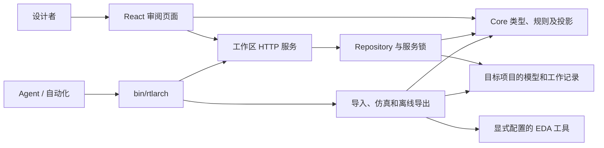

# RTL Architect 项目架构设计说明书

## 1. 目标与范围

RTL Architect 支持 RTL 现状还原、架构共创、逐层审阅和合同交接。它将一笔事务的接收、保存、可见、消费、阻塞和取消落到可追溯的对象及证据。用户可以比较候选、理解取舍、对真实对象提问，并辨认仍需补全的范围。

产品由本机 CLI、工作区服务、审阅页面与 Agent skill 组成。每个 RTL 工程提供自身的源码、构建、Golden、场景和器件约束。工具处理明确声明的数据、结构和有限证据。任意 HDL 行为提取、完整顺序等价、CDC/RDC、器件实现和用户阅读效果均需各自的工具与验收。

## 2. 组件与依赖

| 目录 | 责任 |
| --- | --- |
| [src/core/](../src/core/) | 严格 schema、模型事务与校验、位域/类型求值、状态与事务规则、覆盖、预算、诊断和语义差异。无 React、HTTP 与文件系统依赖。 |
| [src/workspace/](../src/workspace/) | 工作区身份、持久化、预览提交、确认、提案登记、源清单、EDA 记录、输出路径、新鲜度及离线包。 |
| [src/server/](../src/server/) | Express API、校验客户端工作区身份、提供当前构建页面、管理单服务生命周期。 |
| [src/cli/](../src/cli/) 和 [bin/](../bin/) | 解析显式任务、查询命令和 schema、提供 JSON 传输、管理或连接工作区服务。 |
| [src/web/](../src/web/) | React 交互、图形准备与路由、对象详情、核验和审阅。绘图计算供页面、CLI 与离线导出共用。 |
| [.agents/skills/rtl-architect/](../.agents/skills/rtl-architect/) | 使用流程、建模约定和 Agent 任务路由。脚本按实际安装路径交由同一个 CLI 执行。 |
| [examples/](../examples/) 和 [scripts/](../scripts/) | 可复制的通用例子、分组维护回归、固定上游独立基准、浏览器流程与源码交付。 |

核心校验采用严格 Zod schema 及跨字段规则。机器通过 `help --json` 和 `schema <name> --json` 发现实际接口。网页和 CLI 复用模型与领域规则。

## 3. 存储、版本和写入

| 工作区内容 | 权威或用途 | 并发与版本 |
| --- | --- | --- |
| `architecture/model.json` | 设计语义、模块/端口、连接、状态、合同、来源与覆盖声明 | `modelHash` 用规范序列化求 SHA-256，包含 provenance。新建 IR 3，读取 IR 1/2 保持旧内容与 hash。 |
| `architecture/layout.json` | 作用域位置、视口及附着在模型版本上的阅读约束 | `layoutHash` 独立，保存核对 `baseLayoutHash`。 |
| `architecture/module-reviews.json`、`architecture/review.json` | 局部确认与整体批准 | 依赖指纹决定局部失效，整体绑定完整 `modelHash`。无指纹的历史确认保守处理。 |
| `architecture/workbench.json` | 讨论、checkpoint、预算与用户决策 | 执行写入前核对 `workbenchHash`、目标模型、候选、实例与对象。 |
| `proposals/registered/<id>.json` | 不可变提案，保留原基线和候选 SHA-256 | 可为 READY、APPLIED 或 STALE。链接核对 workspaceId。候选重新预览产生新依据。 |
| `evidence/` | 外部运行、结构、状态和回放的追加式产物 | 输入、产物、模型、工具和检查器版本独立核对。 |
| `generated/` | 从模型派生的 Spec 与实现合同 | 使用 handoff 时核对版本及内容。 |
| `.rtlarch/` | 本机服务锁、服务元数据、构建日志及页面工作区偏好 | 协议、版本、构建、真实工作区和实例身份联合核对。 |

Repository 串行处理工作区操作。语义提交以当前 `baseHash` 执行语义命令，再核对预览产生的 `candidateHash` 和可提交诊断，通过临时文件与重命名原子保存模型。确认依据根据模型依赖重新计算。部分还原和未表达结构可保存为草稿，同时保留审阅与交接阻断。每个目标项目使用一个持有工作区锁的写入服务，网页与 Agent 经同一服务访问。

正常链路是 **声明输入 → 预览 → 登记 → 用户审阅并保存草稿 → 局部确认 → 整体批准 → 导出和交接**。比较、讨论、布局、预算、运行和导出不会隐式作出用户选择。批准记录用于本地协作，身份未认证，RTL 实现一致性另以验证证据说明。服务运行中禁止绕开仓库直接改权威文件。

## 4. 结构、类型与时序表达

- 层级兼顾模块定义与完整实例身份，显示分组仅改变阅读。局部状态和边界不是额外 RTL 实例。IR 3 原生数组支持 **1–4096** 个同构叶实例，元素覆写经语义提案，连接展开使用实际索引。端口位宽与位域校验明确检查覆盖及驱动重叠。
- `signal` 支持单驱动扇出和真实反馈。`rv` 连接要求一对一、无事务环，ready 反向。端口按显式类别分组，只默认折叠已声明的配置和时钟复位组。信号名称作为标识使用。
- 类型及位宽解析沿显式 `self` / `parent` 参数关系传播，支持受限整数表达式与有类型的直接参数引用。按位切片、拼接和端点为 unsigned 位向量。表达式 `cast` 显式重解释、扩展或截断，二元算术/位运算/比较与 MUX 数据须满足宽度和符号规则。移位量为 unsigned。外层赋值不隐式改变中间运算宽度。
- 时钟、复位、优先级与默认保持由模型显式记录。纯组合或无复位使用 null，未知时序标记 unknown。同步整向量寄存规则可表达条件、值、复位和保持，依赖集合须一致。旧的输入集合保持原表义，sourceText 用于追溯。状态覆盖区分常量可判的不可达、实际触发、未触发和有区分性的优先级竞争。
- 现状还原的来源包含配置、文件/证据摘要、配置覆盖、部分表达与已知缺口。直接来源、受限推断、已执行证据分别记录。诊断归因需要匹配 issueCode 与目标范围。只有相关关系时保留为关联。

## 5. 图形投影与对象协同

`core/inspection` 与 `hardwareView` 对当前模型生成语义信息。图形由 `scopeDiagram` 构建作用域、模块与端口，`readingProjection` 为主事务总览和局部状态生成显示对象。完整图可选架构、微架构和原始连接。显式阅读意图覆盖主线、控制、邻接、分区、并行、共享资源及反馈。

约束先映射到可见对象，再以 `applied`、`internal_to_group`、`not_applicable` 或 `unsupported` 逐条报告。单成员组保留原身份。聚合节点与关系保留原成员及端点，依赖束与物理网络分别表示。端口锚点属于实际模块，电气分叉依据真实来源端点，MUX 选择由 AST 标注。

`prepareDiagram`、`readingLayout`、`orthogonal` 与 `route` 负责准备、布局、避障与路由。完整保存位置优先，显式约束用于对应版本。Worker 可终止，几何缓存以模型、scope、位置与展开配置为键。小图可有限试探布局，须比较真实节点、边、交叉、路径距离、共线重叠和线名；手动布局和大图保留边界。在线图、SVG 和离线页共用投影及几何。

Quality 独立报告几何、模型连接对应、语义缺口、阅读约束以及阅读任务步骤。任务可以引用真实对象、连接、证据 ID 和 `gapId`。即使原始图只有常量连接且几何通过，RAM 读写未还原时同一任务仍可明确为受阻。显示简化的计数与同图路由改善分别审阅。

`SelectionRef` 绑定版本、scope、实例、投影身份和原始关系成员。图高亮、右侧详情、提问、checkpoint 和跨层定位走同一对象引用。普通选择只更新样式与详情，扩大追踪范围需明确操作。新版失效目标保留历史及原因。面板尺寸与证据展开属于显示状态。

下一状态逻辑锥可从模型 AST 解释条件、值、类型、优先级和保持，也可查看显式 RTL 状态观察中的有限逻辑。两种来源分别标识，上游寄存状态默认是边界。

## 6. 验证证据与失效规则

### 执行与来源

`verify` 只执行 CLI 显式传入的 argv 清单，在新运行目录记录声明输入前后摘要、产物、退出、耗时、工具版本、测试结果和运行前批准依据。支持非空 JUnit、文本、产物和义务检查，失败优先保留。网页仅查看已有记录与源证据。报告路径、符号链接及 UTF-8 请求有边界校验，请求上限 8 MiB。

`import-yosys` 仅解读给定网表的真实层级、端口、参数和位连接，未知单元和未表达结构保留为缺口。v2 导入可从成功的源文件展开取同一份配置及网表，生成 conformance 与状态发现起点。源配置使用 `elaborationInputs` 显式声明，排除已保存模型、生成合同及服务状态。复用旧生产运行时保存生产和当前模型两种版本，验证配置、网表及输入仍新鲜。变更影响检查基于已声明输入和依赖。

### 核对与边界

| 机制 | 支持与结论 |
| --- | --- |
| `checks`、状态覆盖与 `assurance` | 明确接口与同域同步整向量规则生成有限监视器。复位、可达分支、保持及声明的优先级需要对应场景。还原匹配与已批准需求依据分开。 |
| `conform` | 用显式作用域和端点映射比较结构，保留未知参数和未表达连接。跨层的网表位标识须经各自作用域映射。 |
| `observe-state` | 逐实例在支持的 Yosys 单元和完整 `$dff` 上计算二态单步函数。v2 上限 16 域、32 映射、64 发现；已比较状态与发现数独立。 `yosys-proc-bdd-v3` 按同权位交织变量，使用 50,000 节点及 500,000 次运算预算。未知/超限为 UNKNOWN，差异附单步反例。 |
| `replay` | 单域级联单槽、旁路、简单单槽、双槽 skid。按接受事件识别事务，保持启用的负载和 sideband 组合身份。关系声明、环境前提和实际场景覆盖分别报告。 |
| 独立 `verify` | 地址化 RAM FIFO、帧、超出回放结构或复杂设计使用自己的测试、端口队列和采样结果。可在当前页面读取 scoped 的通过、失败和过期记录。 |

状态汇总依据每个声明的 update 选择最新相关记录。重测少量状态、仅发现状态或筛选模块，不能隐藏其他失败。来源或检查器变化会使旧记录过期，历史仍可查看。回放检查器 3 按实际时间选择历史，保留接受、消费、阻塞、恢复、取消与结束在途。环境违规定位在输入。MATCH、OBSERVED 与几何通过各自限于其声明范围。

## 7. 本地交付与维护

`bin/rtlarch` 按真实路径加载源码，保留调用者 cwd。服务只绑定 loopback。浏览器依据版本、workspaceId 和源构建指纹选择服务，过期服务经用户显式重启。Node、npm 与锁文件固定，Vite 生成 `dist/` 及构建身份，构建输入包含页面引用的预算示例。

`bundle` 为目标工作区生成离线审阅成果，保留收起范围、trace、Spec、来源及清单。源码交付由 `npm run release -- --check` 从白名单生成，并在另一份临时副本中重装、构建、通过 skill 打开含空格路径的工作区。两类交付均使用新目录。源码交付保留文档、示例、上游许可证及复跑入口。

验证由 workspace、diagrams、verification、workflow 四组维护流程，以及两个固定上游基准和统一浏览器入口提供。通用检查覆盖失败与边界，独立上游保留原版 scoreboard 和矩阵。发布依据以 [VALIDATION.md](../VALIDATION.md) 的本轮实跑为准，版本变化见 [HISTORY.md](HISTORY.md)。
