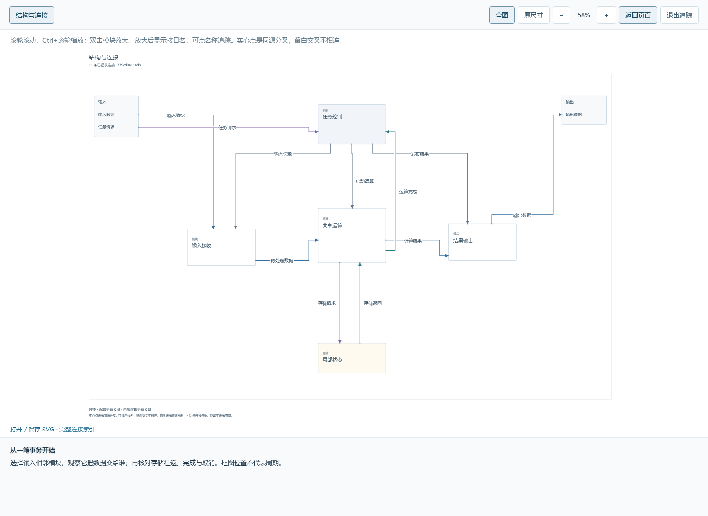
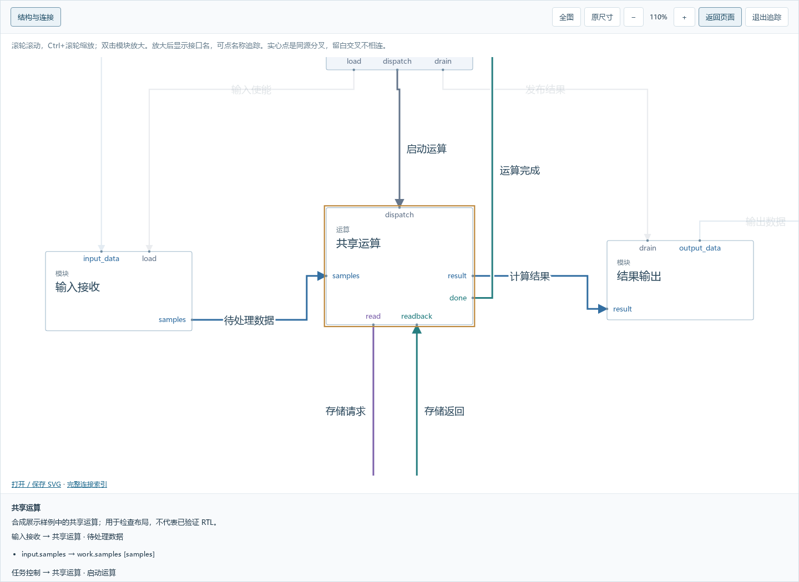
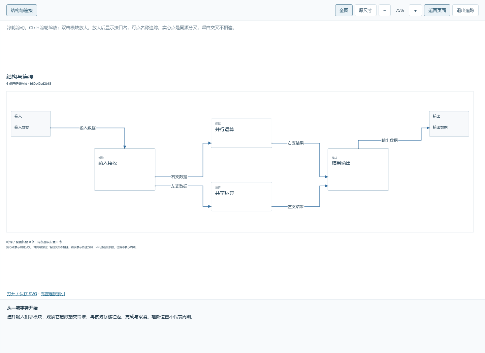

# 0.10：默认阅读布局

把项目样稿中的阅读方法纳入首次交付：skill 根据实际 RTL 证据整理接口用途，工具直接提供可浏览的布局，不要求用户先写坐标或提出“美化”。

## 默认行为

- 未声明业务组的信号保留原端口名和独立身份，同名或同协议不代表一条总线。只有显式时钟/复位、配置组可以默认折叠。
- 依据声明的模块类型与连接，把未声明承担数据通路的控制模块放在上方，单一使用者的局部存储靠近使用者。共享存储、通路内存储及处理数据的控制模块保留在主拓扑。
- 分层排列主结构，保留并行、汇合与反馈。按连接密度扩大间距，重新测量四侧端口占用；输入输出短线也为名称留空间。
- 在线和离线使用同一布局函数。空位置或缺少模块位置时自动排列；完整保存位置与显式 reading 优先。缩放、追踪不移动模块，不修改语义或保存位置。
- 新设计与现状还原同步整理各交付层级的职责、业务组与阅读主线。位置调整自主完成，用户参与重要架构取舍和事务讲解。

## 通用样稿

下面是合成测试模型的实际浏览器截图，未设置手工坐标或 reading，不含真实项目材料。

运行 `npm run check:auto-reading -- /tmp/rtlarch-reading-preview` 可生成九类样稿的独立 HTML；输出目录下各子目录的 index.html 可直接打开。再次生成使用新目录，已有成果不会被覆盖。

## 使用与边界

更新、构建并重启自己工作区的服务后，新模型直接使用新布局；已有完整位置点击“自动布局”预览，满意后再保存。离线 HTML 保留生成时的代码和模型，需重新导出才能更新。

这是结构化模型的展示能力，工具仍不自动解析任意 Verilog/SystemVerilog。业务分组依赖源码证据，不能靠端口命名猜测。九类样例不代表全部 RTL；共享存储等复杂图仍有交叉，几何通过不等于已验证硬件或保证任意设计美观。没有强制改动已保存模型、批准状态或真实 RTL。
